# Evidencia de verificación funcional, desempeño y seguridad

**Fecha de ejecución:** 2026-11-21  
**Rama:** `28-12-verificación-de-casos-desempeño-200-turnos-y-seguridad`  
**Alcance:** CV-01 a CV-10, RNF-P01, RNF-S02, RNF-S03 y RNF-R02.

## Resumen

| Verificación | Resultado |
|---|---|
| `mvn verify` | **PASS** — exit code 0; 53 pruebas, 0 fallidas, 0 errores, 0 omitidas. |
| RNF-P01 | **PASS automatizado** — las cuatro operaciones con 200 turnos persistidos tardaron menos de 3 ms cada una en esta ejecución; límite: 2000 ms. |
| CV-01 a CV-10 | **PASS en pruebas de dominio automatizadas; pendiente en interfaz.** El punto de entrada actual solo muestra un diálogo de inicio; no ofrece controles para registrar, consultar, asignar o finalizar. |
| RNF-S02 | Sin patrones de secretos en archivos entregables. Los reportes locales ignorados de `target/` contienen rutas absolutas del equipo; no deben compartirse ni agregarse al repositorio. |
| RNF-S03 | La inspección del código no encontró APIs de red; la prueba en modo desconectado no se ejecutó. |
| RNF-R02 | **PASS automatizado** — las pruebas existentes verifican que los rechazos preservan el estado. |

## Casos funcionales de referencia

Los siguientes casos son la cobertura automatizada actual y la evidencia visual que quedaría por capturar. **“Automatizado” no significa que se haya ejecutado en una interfaz**.

| Caso | Escenario y resultado esperado | Prueba automatizada ejecutada | Estado | Evidencia visual |
|---|---|---|---|---|
| CV-01 | Registrar turnos con ID y secuencia únicos, en espera y al final de la fila. | `RegistroTurnosTest.idsYSecuenciasSonUnicos`; `turnoRegistradoQuedaEnEsperaSinVentanillaYConTimestamp` | PASS automatizado; interfaz pendiente | 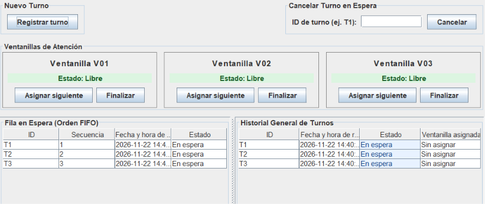 |
| CV-02 | Consultar la fila en orden FIFO y excluir turnos que ya no están en espera. | `ColaFifoTest.consultarFilaDevuelveOrdenFifo`; `filaExcluyeTurnosQueYaEstanEnEspera` | PASS automatizado; interfaz pendiente | 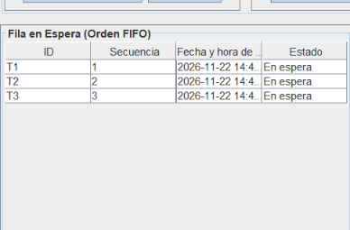 |
| CV-03 | Asignar el turno más antiguo a una ventanilla libre y mostrar su ocupación. | `SistemaGestionTurnosTest.asignaTurnosEnOrdenFifoSinImportarLaVentanilla`; `ventanillasMuestranTurnoActualOLibre` | PASS automatizado; interfaz pendiente | 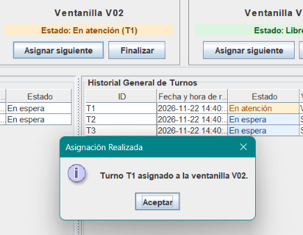 |
| CV-04 | Rechazar asignación en ventanilla ocupada sin cambiar la cola ni el turno activo. | `SistemaGestionTurnosTest.rechazaAsignarSobreVentanillaOcupadaSinCambios` | PASS automatizado; interfaz pendiente | 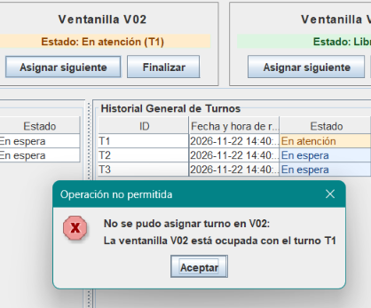 |
| CV-05 | Rechazar asignación con la fila vacía sin ocupar ventanillas. | `SistemaGestionTurnosTest.rechazaAsignarConFilaVaciaSinCambios` | PASS automatizado; interfaz pendiente | 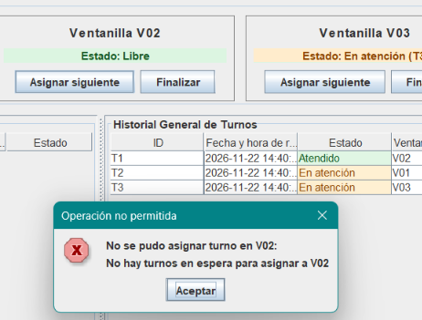 |
| CV-06 | Finalizar una atención, marcar el turno atendido y liberar la ventanilla. | `SistemaGestionTurnosTest.finalizarAtencionLiberaLaVentanillaYMarcaAtendido` | PASS automatizado; interfaz pendiente | 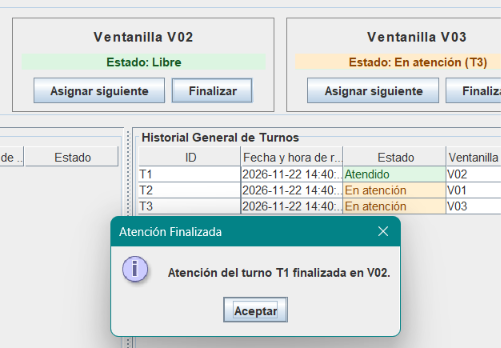 |
| CV-07 | Rechazar finalización desde una ventanilla libre sin alterar otra atención. | `SistemaGestionTurnosTest.rechazaFinalizarVentanillaLibreSinCambios` | PASS automatizado; interfaz pendiente | 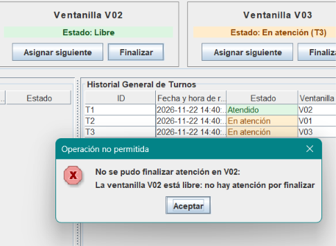 |
| CV-08 | Cancelar un turno en espera, retirarlo de la fila y conservarlo en el historial. | `CancelacionTurnosTest.cancelarTurnoEnEsperaLoRetiraDeLaFilaYLoConservaEnHistorial` | PASS automatizado; interfaz pendiente | 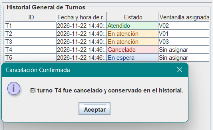 |
| CV-09 | Rechazar cancelación de ID inválido/inexistente o de un turno no cancelable, sin modificar datos. | `CancelacionTurnosTest.cancelarIdInexistenteOInvalidoSeRechaza`; `cancelarTurnoEnAtencionAtendidoOCanceladoSeRechazaSinCambios` | PASS automatizado; interfaz pendiente | **Imagen 9** 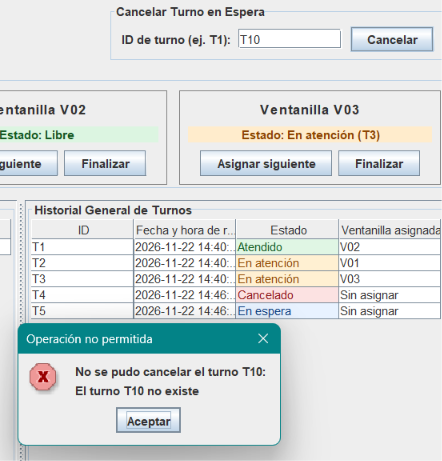 **Imagen 10** 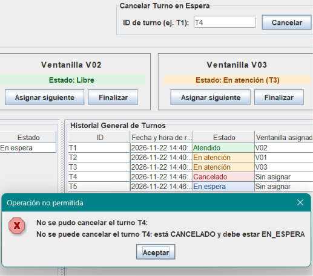 |
| CV-10 | Consultar historial con los estados y recuperar estados/asignaciones después de reiniciar. | `HistorialTurnosTest.historialMuestraLosCuatroEstadosEnOrden`; `PersistenciaTurnosTest.recuperaTurnosEstadosYAsignacionesAlReiniciar` | PASS automatizado; interfaz pendiente | **Imagen 11 — Antes de reiniciar** 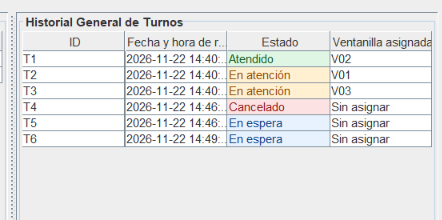 **Imagen 12 — Después de reiniciar** 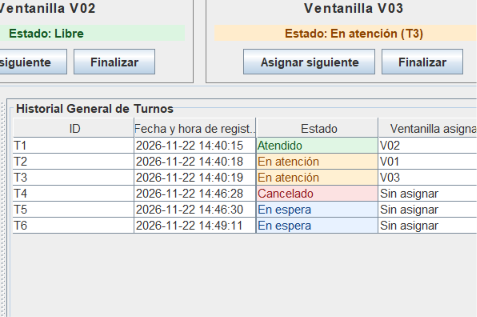 |

### Limitación de ejecución visual

`Main.abrirVista` solo presenta el resumen de arranque; el comentario del propio punto de entrada indica que la ventana funcional se integraría en los issues #9 y #10. No fue posible ejecutar los diez recorridos ni guardar capturas reales en la interfaz. Para cerrar esa parte de aceptación se necesita integrar la vista y repetir los recorridos de la tabla.

Se intentó además un arranque en modo headless, pero PowerShell separó incorrectamente el argumento de la propiedad JVM y Java interpretó `.awt.headless=true` como nombre de clase (`ClassNotFoundException`). Por lo tanto, ese intento no acredita el arranque de la aplicación; `mvn verify` sí terminó correctamente y ejecutó las pruebas de arranque existentes.

## Desempeño — RNF-P01

Prueba reproducible: `mvn -Dtest=RendimientoTurnosTest test`. La prueba usa un archivo temporal y la implementación real de persistencia: precarga 199 turnos, mide el registro que completa 200 y mide consulta de fila, asignación FIFO y finalización con 200 turnos almacenados. Cada operación se cronometra individualmente con `System.nanoTime()` y falla si supera 2000 ms.

| Operación | Tiempo medido | Umbral | Resultado |
|---|---:|---:|---|
| Registrar el turno 200 | 2,172 ms | 2000 ms (2 s) | PASS |
| Consultar fila | 0,228 ms | 2000 ms (2 s) | PASS |
| Asignar siguiente | 2,606 ms | 2000 ms (2 s) | PASS |
| Finalizar atención | 2,102 ms | 2000 ms (2 s) | PASS |

**Resultado RNF-P01: PASS.** 
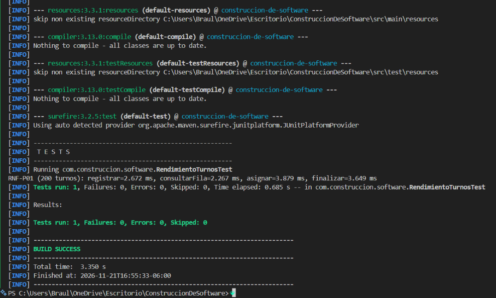

## Seguridad, alcance local e integridad

### RNF-S02 — secretos y rutas privadas

Se revisaron los archivos de texto versionados y no ignorados del espacio de trabajo (25 archivos), incluyendo documentación y `.gitignore`, con patrones para asignaciones de contraseñas/tokens/claves, claves AWS/GitHub, JWT, bloques de llave privada y rutas de perfiles locales. **No se detectaron coincidencias** en los archivos entregables.

También se inspeccionaron los artefactos de texto ignorados. Los XML de Surefire bajo `target/` contienen rutas absolutas locales de compilación (100 coincidencias del patrón de ruta); esos reportes son generados, están cubiertos por `target/` en `.gitignore` y no deben compartirse ni agregarse. No se detectaron coincidencias de claves o tokens en esa inspección. No se encontraron archivos `.tmp`, `.bak`, `.log` ni archivos de datos de turnos en el espacio de trabajo.

**Nota:** esta comprobación por patrones no sustituye un escáner especializado de secretos ni inspecciona el historial Git.

### RNF-S03 — alcance local

La búsqueda en `src/` no encontró referencias a `java.net`, sockets, `HttpClient`, URLs HTTP o APIs de red. La persistencia está implementada mediante archivo local. Esto respalda el diseño desconectable, pero no se realizó una prueba de ejecución con la red deshabilitada.

### RNF-R02 — integridad ante rechazos

Las pruebas de asignación imposible, finalización inválida, cancelación inválida y fallos de persistencia comparan el estado de turnos, ventanillas e historial antes/después. Se ejecutaron dentro del `mvn verify` final, sin fallos.

## Evidencia técnica

- Informe de pruebas: `target/surefire-reports/` (artefacto local ignorado; puede contener rutas del equipo).
- Informe JaCoCo: `target/site/jacoco/` (artefacto local ignorado).
- Nueva prueba de desempeño: `src/test/java/com/construccion/software/RendimientoTurnosTest.java`.

## Pendientes para cerrar la aceptación completa

1. Integrar o proporcionar la interfaz de operaciones y ejecutar visualmente CV-01 a CV-10.
2. Guardar las capturas indicadas en la tabla y reemplazar cada marcador `(IMAGEN: ...)` por la ubicación de la evidencia.
3. Si los XML de Surefire se van a compartir fuera del equipo, anonimizar las rutas locales antes de exportarlos.